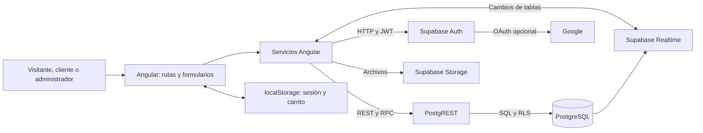
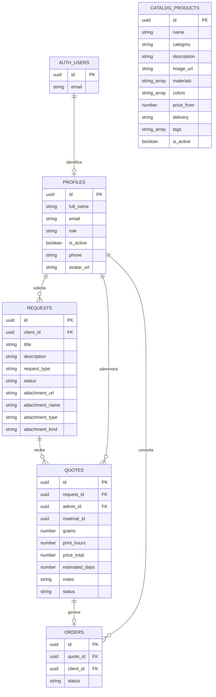

# Arquitectura y esquema preliminar

## Componentes y comunicaciones

Angular contiene módulos públicos, de cliente y de administración. Los guards
controlan la navegación y los servicios centralizan Auth, consultas, RPC y archivos.
El servidor debe validar autorización mediante RLS y funciones; ocultar una pantalla
o filtrar por `client_id` desde Angular es insuficiente para proteger una tabla.

Auth gestiona las credenciales y entrega tokens. El frontend conserva la sesión
y el carrito localmente. Storage contiene objetos; las tablas conservan sus
referencias. Realtime actualiza las vistas cuando cambian solicitudes, cotizaciones
y pedidos. La prueba de OAuth externo se sustituye por respuestas controladas.

## Modelo preliminar de datos

Este esquema se infiere de las [interfaces TypeScript](../../../src/app/interfaces/)
y los [servicios](../../../src/app/core/services/). Las relaciones son el diseño
esperado: las claves, índices, triggers, RLS y funciones del Supabase existente
deben cotejarse antes de afirmar que coinciden con el servidor desplegado.

Las interfaces admiten `created_at` y `updated_at` opcionales. `material_id`,
gramos y horas de impresión son opcionales en las cotizaciones; el código disponible
no basta para definir una tabla de materiales. La relación única cotización/pedido
es una condición esperada de RF-09 que se comprobará en la integración real.

## Contratos consumidos

| Servicio | Contrato |
| --- | --- |
| Autenticación | Auth: signup, token con contraseña, usuario y logout. |
| Perfiles | REST sobre `profiles`; registro y edición de datos permitidos. |
| Catálogo | REST sobre `catalog_products`; catálogo activo y administración. |
| Solicitudes | REST sobre `requests`, filtro por cliente y actualizaciones. |
| Cotizaciones | REST sobre `quotes`; RPC `accept_quote(p_quote_id)` y `reject_quote(p_quote_id)`. |
| Pedidos | REST sobre `orders`, consulta y actualización de estado. |
| Archivos | Buckets `avatars`, `catalog-products` y `request-files`. |
| Notificaciones | Canales Postgres Changes de Supabase Realtime. |

## Entornos de prueba

1. TestBed y Vitest ejecutan lógica de Angular y contratos HTTP con respuestas simuladas.
2. Playwright ejecuta la aplicación en el navegador con backend simulado para escenarios repetibles.
3. Supabase local ejecutará Auth, REST, PostgreSQL y Storage para probar políticas y efectos persistentes con datos ficticios.

El entorno local se prepara de forma independiente de la conexión habitual de la
aplicación. Las migraciones locales, sus pruebas y las diferencias identificadas
con el esquema desplegado deberán versionarse como evidencia de M4.
