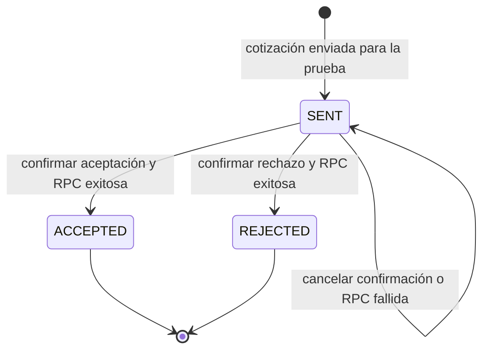
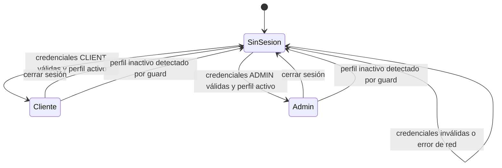

# Tablas de decisión y estados

## DT-01 — Decidir una cotización desde el cliente

`–` = condición irrelevante. Se ejecuta cada fila con un dato independiente.
Vigente significa que el ID coincide con la cotización mostrada para esa solicitud.

| Regla | Vigente | SENT | Operación en curso | Confirma | Acción esperada | Caso |
| --- | --- | --- | --- | --- | --- | --- |
| D1 | Sí | Sí | No | Sí | Enviar una RPC de aceptación/rechazo y reflejar la decisión confirmada. | TC-016 |
| D2 | Sí | Sí | No | No | Conservar SENT y no enviar RPC. | TC-016 |
| D3 | No | – | – | – | No enviar RPC desde la interfaz. | TC-017 |
| D4 | Sí | No | – | – | No enviar RPC desde la interfaz. | TC-017 |
| D5 | Sí | Sí | Sí | – | Bloquear otra decisión hasta finalizar. | TC-017 |

La comprobación de propietario y la unicidad del pedido también se verifican por
API real en TC-016 y TC-028; esta tabla describe el bloqueo del frontend.

## DT-02 — Acceso a una ruta administrativa

| Regla | Sesión y usuario | Perfil activo | Rol | Resultado | Caso |
| --- | --- | --- | --- | --- | --- |
| A1 | No | – | – | Redirigir a `/login`. | TC-007 |
| A2 | Sí | No | Cualquiera | Cerrar sesión y denegar acceso. | TC-007 |
| A3 | Sí | Sí | CLIENT | Redirigir a `/client/dashboard`. | TC-007 |
| A4 | Sí | Sí | ADMIN | Permitir la ruta administrativa. | TC-007 |

## DT-03 — Acciones sobre solicitudes propias

| Estado | Editar | Eliminar | Cancelar | Caso |
| --- | --- | --- | --- | --- |
| PENDING | Sí | Sí, con confirmación | No | TC-022 |
| IN_REVIEW | No | No | Sí, con confirmación | TC-022 |
| QUOTED | No | No | Sí, con confirmación | TC-022 |
| CANCELED | No | No | No | TC-022 |
| CLOSED | No | No | No | TC-022 |

Estas reglas describen disponibilidad de acciones en el cliente. La autorización
por API se valida separadamente; el servidor debe impedir cambios ajenos aunque
se omita la interfaz.

## ST-01 — Decisiones sobre cotización

| Transición / intento | Resultado | Caso |
| --- | --- | --- |
| SENT → ACCEPTED | Un pedido asociado; estado persistido. | TC-016 |
| SENT → REJECTED | Sin pedido nuevo; estado persistido. | TC-016 |
| SENT → SENT por cancelación | Sin RPC ni cambio. | TC-016 |
| ACCEPTED/REJECTED/DRAFT/EXPIRED → decidir | Acción bloqueada; no se envía RPC desde el cliente. | TC-017 |
| SENT → SENT por error 500 | Mensaje y posibilidad de reintento; sin falso éxito. | TC-021 |
| Recargar tras decisión | Se conserva el estado del servidor. | TC-018 |

El diagrama muestra el flujo bajo prueba; no afirma que DRAFT o EXPIRED sean
inalcanzables en el modelo completo ni que exista un proceso automático de expiración.

## ST-02 — Sesión y acceso

TC-005 verifica entrada y salida; TC-006 y TC-019 los intentos fallidos;
TC-007 la detección de perfil inactivo y las rutas por rol.
