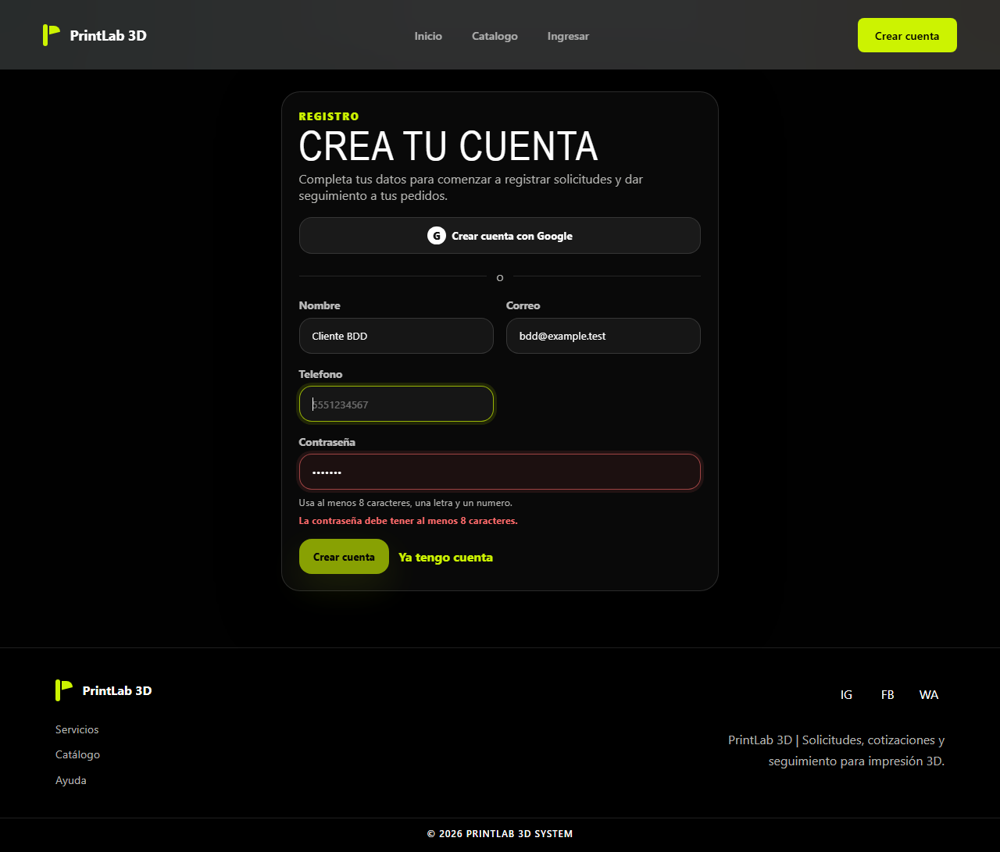
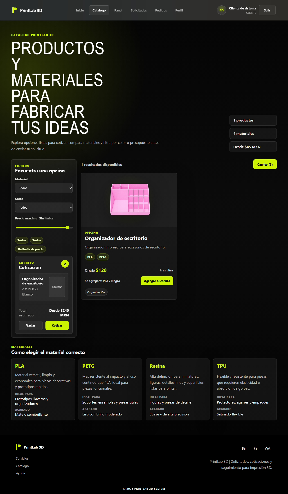
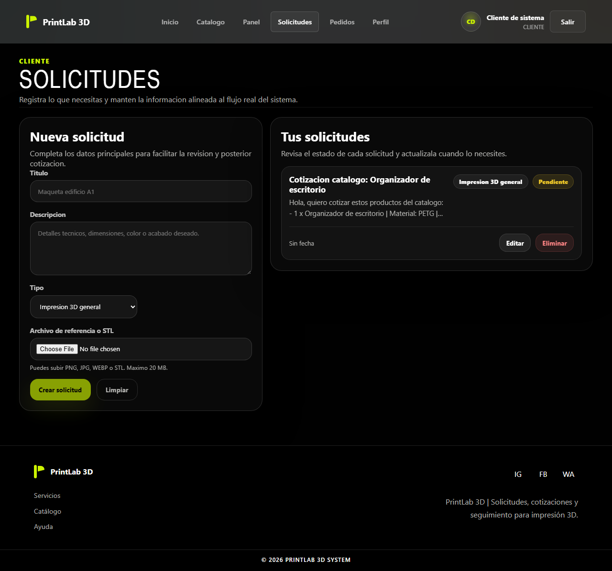
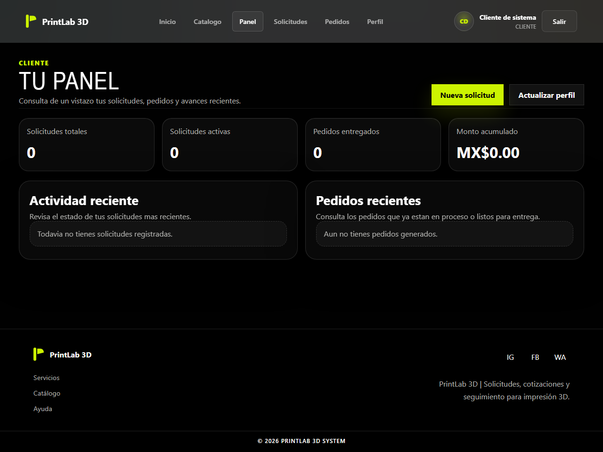
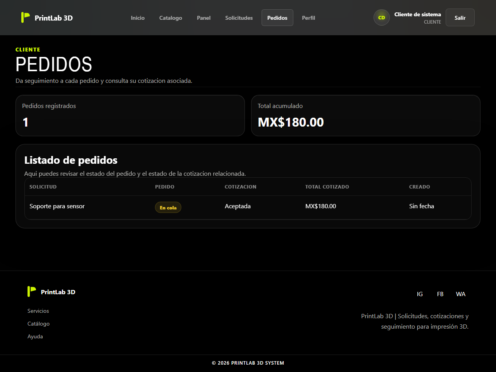

# M6 — Reporte de pruebas de sistema

Ejecución local: **26 de noviembre de 2026**. Entorno: Windows, Node.js 22.14.0,
Playwright 1.65.1 y Chromium headless. Aplicación: `http://127.0.0.1:4307`.
Backend: **Supabase simulado por escenario**. La ejecución final generó HTML,
JUnit y 15 capturas; no se configuraron reintentos ni esperas fijas.

## Resultado

| Feature | Escenarios | Aprobados | Fallidos | Omitidos | Suma de tiempos de casos |
| --- | --- | --- | --- | --- | --- |
| Acceso por rol | 3 | 3 | 0 | 0 | 3.436 s |
| Autenticación | 3 | 3 | 0 | 0 | 3.722 s |
| Catálogo y carrito | 3 | 3 | 0 | 0 | 5.278 s |
| Cotizaciones y pedidos | 3 | 3 | 0 | 0 | 5.993 s |
| Solicitudes | 3 | 3 | 0 | 0 | 5.217 s |
| **Total** | **15** | **15** | **0** | **0** | **13.809 s de ejecución en paralelo** |

Los tiempos de casos se solapan porque hay cinco workers; no miden rendimiento
de producción. Comandos: `npm run test:system:check` y `npm run test:system`.
TypeScript pasó y los cinco archivos Gherkin generaron 15/15 pruebas aprobadas.
Durante el refactor se corrigió el selector de solicitudes para usar su rol real
`listitem`; era un fallo del Page Object, no un defecto de la aplicación.

## Código y trazabilidad

Los [cinco features](../../../system-tests/README.md) conservan los cuatro
escenarios originales y añaden once. Los [cinco Page Objects](../../../system-tests/pages/)
separan las acciones del navegador de los [steps](../../../system-tests/printlab.steps.ts).

| Requisitos | Alcance |
| --- | --- |
| RF-01, RF-02 | Validación de registro, acceso inválido y cierre de sesión. |
| RF-03 | Redirecciones por sesión/rol; no autorización real por API. |
| RF-04, RF-05 | Filtros, cantidades, total y almacenamiento local del carrito. |
| RF-06, RF-07 | Solicitud desde carrito, límites de entrada y formato no admitido. |
| RF-09, RF-10, RF-11 | Cotización, decisión y pedido bajo contrato HTTP simulado. |

Los datos son ficticios y el estado se aísla por escenario. Persistencia tras
recargar significa localStorage o estado del mock dentro de la prueba; no acredita
PostgreSQL, Storage ni atomicidad de RPC. No se consultó ni modificó la BD habitual.

## Evidencia

- HTML: `tmp/system-report/index.html`; abrir con `npx playwright show-report tmp/system-report`.
- JUnit: `tmp/system-results.xml`; capturas por caso y trazas de fallos en `tmp/system-results/`.
- [Workflow](../../../.github/workflows/system-tests.yml): instala Chromium, comprueba TypeScript, ejecuta BDD y guarda artifacts por 14 días.
- El CI del PR de M6 se registra al publicarlo; un PR anterior no valida los once escenarios nuevos.

### Registro con contraseña corta

### Carrito conservado después de recargar

### Solicitud creada desde el carrito

### Cliente redirigido desde una ruta administrativa

### Pedido tras aceptar cotización

## Pendientes generales

Se cubre el mínimo de M6 en Chromium, sujeto al CI y revisión del PR. RLS/RPC/Storage
reales esperan el SQL del equipo. Móvil y otros navegadores de RNF-07 permanecen
pendientes; no se deducen de esta ejecución de escritorio.
