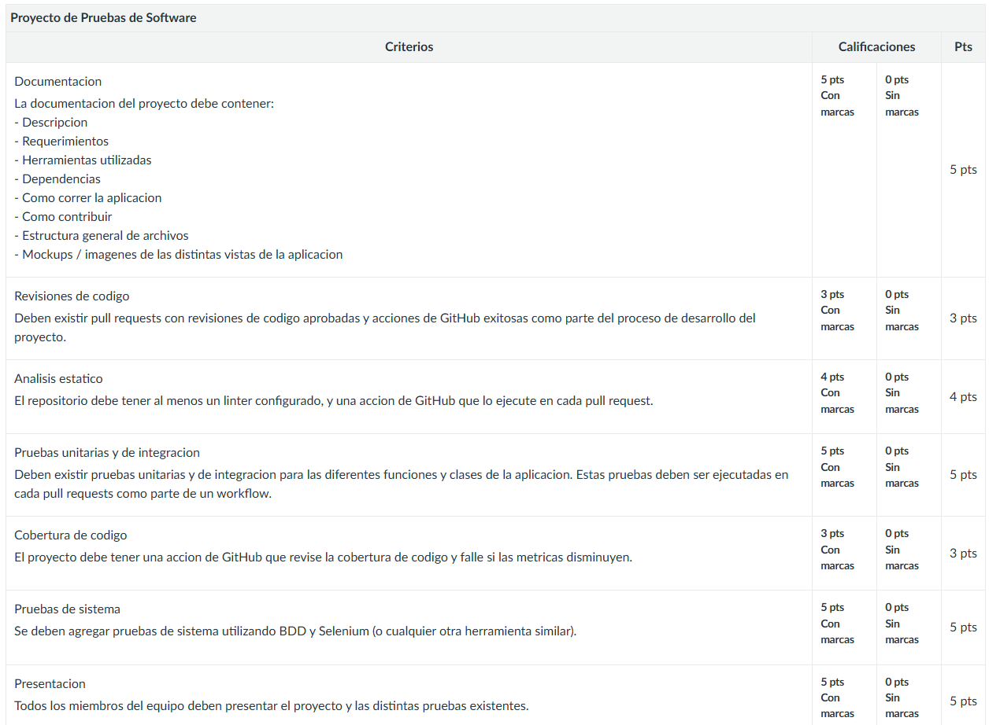

# Rúbricas del proyecto

## Rúbrica de entrega: 30 puntos

La [captura original](proyecto-pruebas-software.png) contiene siete criterios:

| ID | Criterio | Puntos | Requisito |
| --- | --- | ---: | --- |
| R1 | Documentación | 5 | Descripción, requerimientos, herramientas, dependencias, ejecución, contribución, estructura e imágenes de las vistas. |
| R2 | Revisiones de código | 3 | Pull requests con revisiones aprobadas y GitHub Actions exitosas durante el desarrollo. |
| R3 | Análisis estático | 4 | Al menos un linter y una acción que lo ejecute en cada pull request. |
| R4 | Pruebas unitarias y de integración | 5 | Pruebas de las funciones y clases de la aplicación, ejecutadas en cada pull request. |
| R5 | Cobertura de código | 3 | Una acción que revise la cobertura y falle cuando disminuyan las métricas. |
| R6 | Pruebas de sistema | 5 | Pruebas con BDD y Selenium o una herramienta similar. Playwright se usa como herramienta de navegador. |
| R7 | Presentación | 5 | Todos los integrantes presentan el proyecto y sus distintas pruebas. |
| | Total | 30 | La calificación corresponde al profesor; esta tabla organiza la evidencia. |

## Guía general por hitos

La [guía de team-project](https://github.com/jp-garduno/software-testing-fall-2026/tree/main/team-project)
añade los entregables M1–M7. Sus cantidades mínimas de casos, TDD, Page Objects y JMeter
se registran aparte en la [matriz de cumplimiento](../rubrica.md).

El equipo cuenta con autorización del profesor para reutilizar el proyecto Angular + Supabase.
Los resultados de pruebas con respuestas simuladas se distinguen de las verificaciones de
una base de datos real. Las ejecuciones, aprobaciones y entregas se documentan cuando ocurren.

